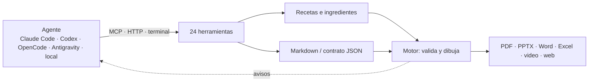
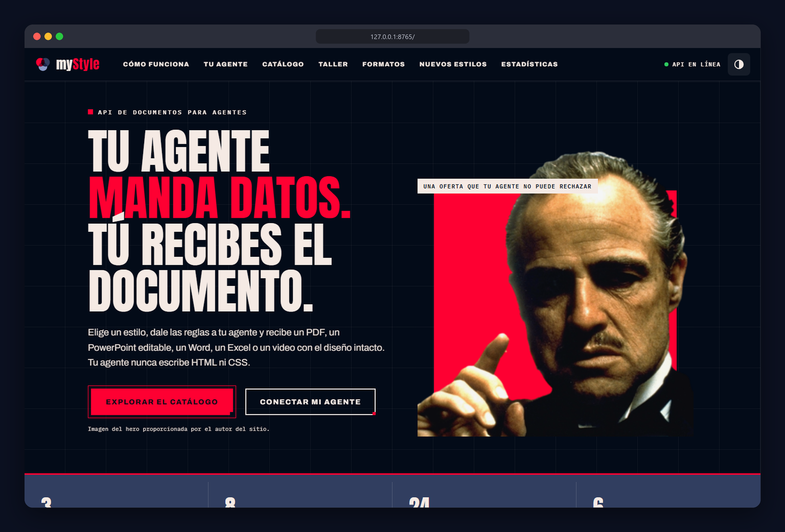
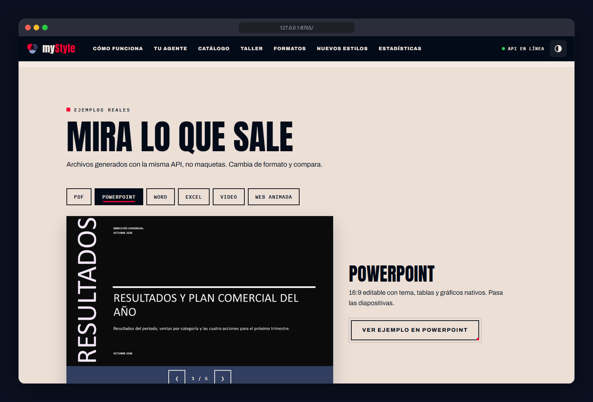
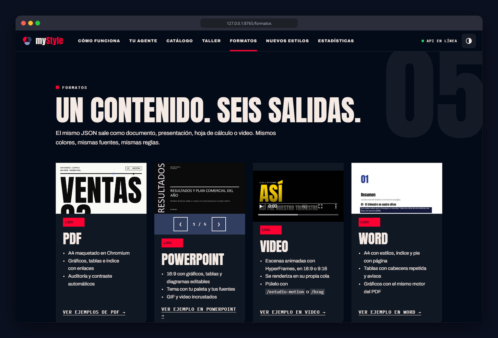
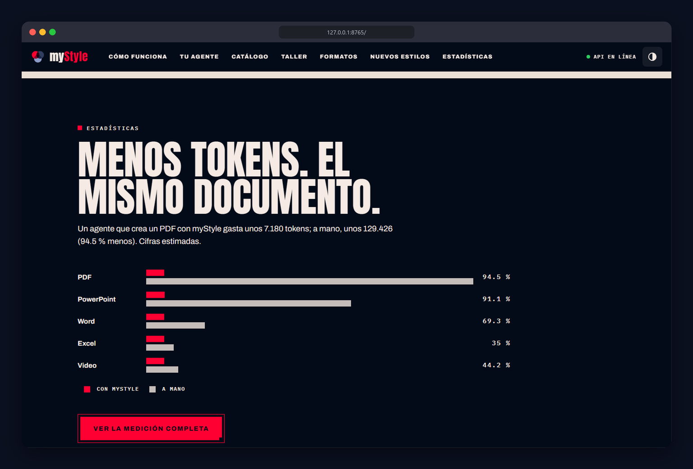
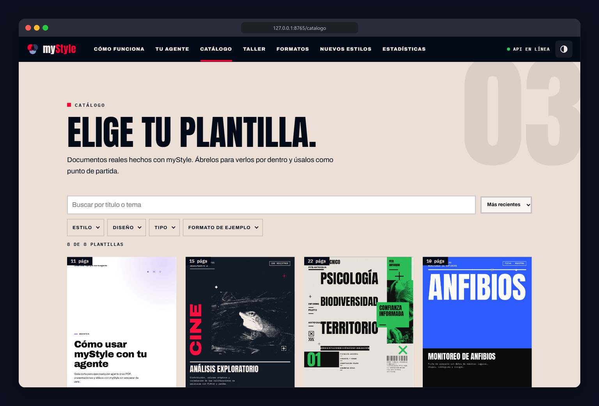
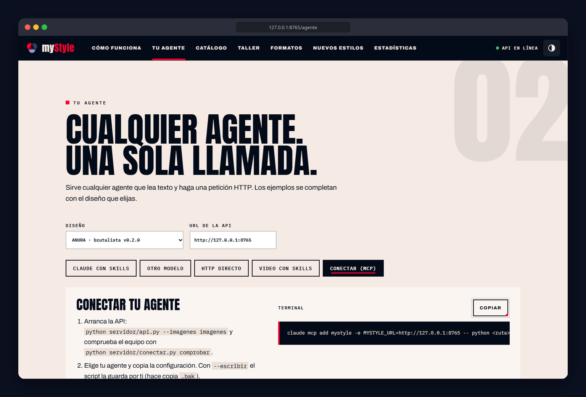

<div align="center">

# myStyle

**Tu agente manda datos. Tú recibes el documento.**
API local que convierte contenido en **PDF, PowerPoint, Word, Excel, video y páginas web animadas** con un diseño intacto, para cualquier agente de IA: Claude Code, Codex, OpenCode, Antigravity o un modelo local.

[](docs/media/hero.mp4)

*Clic en la animación para ver el video completo (38 s): la web servida, renderizada con HyperFrames en estilo brutalismo. Incluye la sección `/brag`: «Haz trabajar a Haiku como si fuera Opus».*

**[Ver la web (demo estática)](https://mogollo7.github.io/guia/)** · [Conectar un agente](#conectar-tu-agente) · [Herramientas](#herramientas) · [Decisiones](docs/decisions)

</div>

---

## Qué es

Un agente de IA que escribe HTML y CSS a mano gasta decenas de miles de tokens y entrega márgenes rotos. Con myStyle **el agente solo entrega contenido**: el motor lo dibuja con un diseño declarativo, lo valida (contrato, contraste, márgenes, redundancia) y devuelve avisos que el agente corrige sin rehacer nada.

Lo nuevo es el **supermercado**: el agente no escribe el documento desde cero, va por ingredientes y recetas ya listas y solo rellena los huecos.

| Nivel | Qué es | El agente escribe |
|---|---|---|
| Ingrediente | Una pieza suelta con huecos (4 cifras, tabla comparativa, 5 pasos…) | 1–3 campos |
| Receta | Un documento completo con huecos y valores por defecto (informe, acta, propuesta…) | solo los huecos (~100–300 tokens) |
| Archivo | PDF, PPTX, Word, Excel, video o web | nada |



## Míralo funcionando

La web se sirve desde la misma API. Estas capturas son de esa web.

<table>
<tr>
<td width="50%"><br><sub>Inicio</sub></td>
<td width="50%"><br><sub>Ejemplos reales: PDF, PowerPoint, Word, Excel, video y web</sub></td>
</tr>
<tr>
<td><br><sub>Un contenido, seis salidas</sub></td>
<td><br><sub>Tokens con y sin myStyle</sub></td>
</tr>
<tr>
<td><br><sub>Catálogo de plantillas</sub></td>
<td><br><sub>Conectar tu agente</sub></td>
</tr>
</table>

## Inicio rápido

```bash
git clone https://github.com/Mogollo7/guia.git && cd guia
pip install -r servidor/requirements.txt && python -m playwright install chromium
python servidor/api.py --puerto 8765 --imagenes imagenes     # http://127.0.0.1:8765
python servidor/conectar.py comprobar                         # qué falta y cómo instalarlo
```

Video: Node 22+ y FFmpeg. Ortografía (opcional): Java y LanguageTool, ver [`servidor/tools/LEEME_CALIDAD.md`](servidor/tools/LEEME_CALIDAD.md).

### Conectar tu agente

`python servidor/conectar.py <agente>` muestra la configuración; con `--escribir` la guarda (hace copia `.bak`).

| Agente | Comando | Configuración |
|---|---|---|
| Claude Code | `python servidor/conectar.py claude-code` | `claude mcp add mystyle …` |
| Codex | `python servidor/conectar.py codex --escribir` | `~/.codex/config.toml` |
| OpenCode | `python servidor/conectar.py opencode --escribir` | `opencode.json` |
| Antigravity | `python servidor/conectar.py antigravity --escribir` | `mcp_config.json` |
| Claude Desktop | `python servidor/conectar.py claude-desktop --escribir` | `claude_desktop_config.json` |
| Cualquier otro | `python servidor/conectar.py http` | function calling estilo OpenAI (`GET /v1/tools`) o terminal |

Después copia el manual a la carpeta de skills de tu agente: `python servidor/conectar.py skill`. Codex y OpenCode leen [`AGENTS.md`](AGENTS.md) de la raíz.

Sin MCP, cualquier herramienta se llama desde la terminal:

```bash
python servidor/herramientas.py call list_recipes '{"q":"informe de ventas"}'
python servidor/herramientas.py call create_from_recipe '{"receta":"informe_negocio","valores":{"titulo":"Ventas del trimestre"},"formato":"pdf"}'
```

## Herramientas

Una sola definición ([`servidor/herramientas.py`](servidor/herramientas.py)) sirve a MCP, a `GET /v1/tools` y a la terminal. El perfil mínimo (`?perfil=minimo`, 9 herramientas) es para modelos pequeños.

| Para… | Herramientas |
|---|---|
| Empezar por una receta | `list_recipes` · `recipe_get` · `create_from_recipe` · `compose` |
| Crear el archivo | `create_pdf` · `create_pptx` · `create_video` · `render` (Word, Excel, web animada) |
| Revisar y corregir | `audit` · `check_quality` (ortografía en español y accesibilidad) · `patch` · `job_status` |
| Crear un estilo | `analyze_reference` · `create_style` · `create_variant` · `validate_style` · `screenshot` |
| Crear recursos | `create_resource` (patrones, fondos, iconos Lucide) |
| Biblioteca y aprendizaje | `search_library` · `library_get` · `save_style` · `save_correction` · `find_corrections` · `get_prompt` |

Manual por tareas para el agente: [`skills/mystyle/`](skills/mystyle/SKILL.md).

## Crear un estilo desde una imagen

El usuario pasa una imagen o PDF y el agente hace el proceso con herramientas, sin escribir CSS:

1. `analyze_reference` lee modo claro/oscuro, acento, paleta y propone el comando.
2. `create_style` genera el diseño (paleta de 7 roles, piel, 4 variantes) y corre los 10 chequeos de validación.
3. `create_variant` añade portadas y divisores; `screenshot` deja ver el resultado para compararlo con la referencia.
4. Lo que el agente crea y sirve otra vez (receta, ingrediente, recurso) se guarda con `save_style` para futuros usos.

Pieles: `suave`, `recta`, `redonda`, `editorial`; modos `claro` y `oscuro`. Ver [ADR-005](docs/decisions/ADR-005-fabrica-de-estilos-con-pieles.md).

## Resultados medidos

Tokens que gasta un agente para entregar el mismo documento (contador estimado: caracteres / 3,6; método en [`TOKENS.md`](servidor/tools/TOKENS.md)):

| Formato | Con myStyle | A mano | Ahorro |
|---|---|---|---|
| PDF | 7 180 | 129 426 | 94,5 % |
| PowerPoint | 7 258 | 81 152 | 91,1 % |
| Word | 7 116 | 23 172 | 69,3 % |
| Excel | 7 073 | 10 885 | 35,0 % |
| Video | 7 083 | 12 697 | 44,2 % |
| **PDF con receta** | **≈ 660** | 129 426 | **≈ 99,5 %** |

## Haiku frente a Opus (prueba breve)

Mismo guion de video, mismo manual (`skills/mystyle/`) y mismas herramientas, un agente cada uno:

| | Haiku | Opus |
|---|---|---|
| Video entregado | 93 s, válido | 99 s, válido |
| Tokens del agente | ≈ 115 000 | ≈ 100 000 |
| Llamadas a la API | ≈ 6 | ≈ 9 |

Los dos terminaron la tarea con el motor validando y señalaron lo mismo: el video solo elegía 3 momentos por parte y no tenía cartas, nombres flotando ni transiciones. Eso llevó al modo `:::motion` (escenas explícitas: palabra, nombres, cartas, flujo, contador, estados, final; ver [`hacer-video.md`](skills/mystyle/tareas/hacer-video.md)). Los videos de esta prueba están en `servidor/web/ejemplos/` (`brag-haiku-r1.mp4`, `brag-opus-r1.mp4`). Es una sola corrida por modelo: no es una evaluación estadística. La repetición con `:::motion` no se hizo.


## Pruebas con Postman

Importa en Postman la colección `postman/myStyle.postman_collection.json` (y el entorno `postman/myStyle.local.postman_environment.json`). Incluye 26 solicitudes organizadas por operación y pruebas automáticas que verifican las respuestas cada vez que le haces una solicitud a la API.
Consulta la [guía detallada de Postman](POSTMAN_DOCUMENTATION.md) para ver cómo importar y ejecutar la colección, el orden de las solicitudes y los resultados esperados.

**1. Verificar la API desde Postman**

* Método: `GET`
* URL completa: `http://localhost:8765/v1/tools`

Respuesta esperada: `200 OK` con la lista de herramientas (`list_recipes`, `recipe_get`, `create_from_recipe`, …). Sin Postman: `npx newman run postman/myStyle.postman_collection.json -e postman/myStyle.local.postman_environment.json`.

## Estructura

| Carpeta | Contenido |
|---|---|
| `servidor/` | API (`api.py`), motor (`engine/`, `render*.py`), herramientas, fábrica de estilos, calidad, web (`web/`) |
| `servidor/designs/` | Diseños declarativos: `anura`, `editorial`, `prompt-master` y los estilos generados |
| `servidor/biblioteca/` | Recetas, ingredientes, recursos, plantillas, componentes y animaciones |
| `skills/mystyle/` | Manual universal para cualquier agente |
| `contenido/` | Ejemplos de contenido (datos, nunca código) |
| `docs/` | Decisiones (ADR), capturas, video del README |
| `postman/` | Colección y entorno de Postman con pruebas automáticas de la API |

Pruebas: `python -m unittest discover -s servidor/tests` · Recetas: `python servidor/tools/probar_recetas.py --render` · Regresión visual: `python servidor/regresion.py --comprobar`.

## Decisiones

Las razones de fondo están en [`docs/decisions/`](docs/decisions): el agente manda datos y el motor valida (001), Markdown y recetas (002), una sola definición de herramientas (003), el modelo más barato primero (004), la fábrica de estilos (005) y la web estática en Pages (006).

## Web en GitHub Pages

`servidor/tools/pages.py` construye la versión estática y `.github/workflows/pages.yml` la publica (activa Pages con fuente «GitHub Actions»). El Taller y el renderizado necesitan la API local; la demo lo avisa.

## Estado del proyecto

Hecho: motor de documentos (PDF, PPTX, Word, Excel, video, web), 12 recetas y 10 ingredientes, fábrica de estilos, recursos, calidad (ortografía y accesibilidad), web con ejemplos reales, manual para agentes, conexión por agente, colección de Postman y web estática para Pages.
Pendiente (fuera de este cierre): crear estilos nuevos con Ollama/Qwen, repetir la prueba Haiku/Opus con `:::motion`, y los formatos extra (PNG/SVG para redes, GIF, EPUB, correo HTML, póster). Seguimiento en [`PENDIENTES.md`](PENDIENTES.md).

## Licencias

Código del servidor: propio. Fuentes: SIL OFL 1.1 (Archivo, Anton, IBM Plex Mono). Librerías incluidas en `servidor/video/vendor/`: anime.js, three.js y lottie-web (MIT); iconos Lucide (ISC); GSAP bajo su licencia «no charge» (revisa sus usos prohibidos si lo distribuyes). Las imágenes de `imagenes/` llevan su autor y licencia en `imagenes/creditos.csv`.
